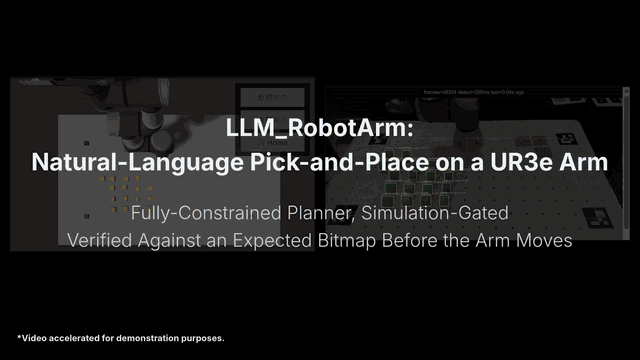
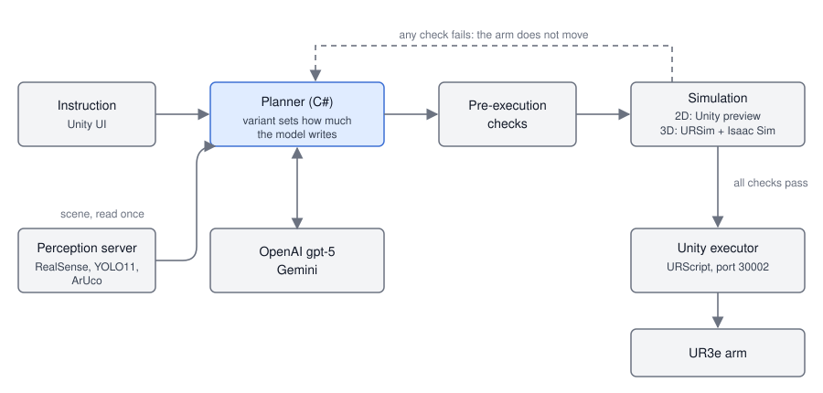

# LLM_RobotArm — Comparing Three Levels of Planner Constraint for Natural-Language Control of a UR3e Arm

LLM_RobotArm turns a Chinese natural-language instruction, such as "arrange the yellow blocks
into the letter L", into a verified pick-and-place program for a Universal Robots UR3e arm.
It was built as a capstone project (專題) by a team of six between May and October 2026, in the laboratory
setting of one workbench with one arm, one camera and a handful of yellow blocks. The people who use it are the team itself; there are no external
users and no deployment.

Calling a language model is not the hard part. The model returns fluent text for any
instruction, and fluent text is not a trajectory. Three things took the work.

**Deciding where the model stops and code starts.** A planner that writes every pose can
attempt any task and fails on reach limits and collisions; a planner that only fills in a
fixed template never fails that way but can only do what the template anticipated. The project
builds the same system three times, at three levels of constraint, so the choice can be
examined instead of assumed.

**Checking a plan before the arm moves.** A failed attempt on the real arm changes the table,
and the next attempt starts from a different problem. Every variant therefore verifies a
whole batch in simulation first (Unity for flat figures, URSim and Isaac Sim for stacked
ones) and moves the arm only if the batch passes.

**Keeping the arm's real geometry honest.** The gripper opens 3.5 cm, not the 7 cm the
simulation first assumed; the fingers are 15 mm square, not the 21 by 20 mm of the asset
model; a descent that is a few millimetres too deep crushes the block underneath. Much of
the work of the project was these corrections.

This repository contains the three variants, their shared verification flow, the offline
checks that pass, and an export and census of every recorded run that exists: 23 experiment
tasks with 65 attempts, and 89 finished commands of the earlier planner. These are a small part
of the experiments the team ran: the owner estimates about 500, run together on several
computers, whose records the owner cannot reach. The repository therefore does not contain a
completed success-rate comparison. The records that are available show real-arm trials that ended
in infrastructure errors and simulation trials that were stopped by hand with no success, and
`docs/metrics.md` says so number by number.

---



*Instruction issued → verification gate enabled → simulation-only planning → batch verified
against the expected bitmap → physical execution → 12 / 12 placed correctly.*

[2D full demo (17 min)](https://youtu.be/buLcFnzc7SU) · [2D short demo (29 sec)](https://youtu.be/hMH1wXtTpaM)

---

## What it does

**Reads the table once per instruction and then works from simulation.** A RealSense D435i
streams 1920 by 1080 colour at 15 frames per second to a Python perception server. Yellow and
black cubes and dominoes are found by colour (HSV) and shape, ArUco markers QR1 to QR4 give the
workbench frame, and YOLO11n serves a whitelist of seven everyday objects. Block positions come
from a ray onto the plane at the 2.5 cm cube height, with height from the depth image, refreshed
every 0.2 s over a 5-frame window. The planner waits until three consecutive frames match, takes
that scene, and reads the camera no more; every later check looks at a simulated view.

**Draws a target figure with two models before planning.** For a figure such as a letter,
OpenAI (gpt-5 by default) and Gemini each draw a bitmap of at most 5 by 5 cells, review each
other's drawing, and the survivors are scored 80% / 20% in favour of OpenAI, for at most two
rounds. For a stacked figure the same procedure draws a height map of one row by three
columns by three layers. A switch in Unity turns the review off, in which case OpenAI draws the
figure once. How the figure is used differs by variant: it scores the result (0%), it must match
the plan cell for cell (50%), or it is mapped to coordinates by code (100%).

**Gives the planner a different share of the decisions in each variant.** In the 0% variant a
decomposition call and a planning call write text, and a third call turns it into JSON in which
the model supplies the source block, the target and a full TCP pose (position and rotation) for
every move; the joint angles are solved by Unity's own kinematics for flat figures and by URSim
for stacked ones. In the 50% variant the model writes the plan as text
and a deterministic adapter reads the source index, the target coordinates and six function
names from it. In the 100% variant a router classifies the instruction into four actions, code
chooses sources and computes every coordinate, and the model only orders a whitelist of robot
functions for each step.

**Refuses to move the arm until a simulation has said yes.** A flat figure passes when a
top-down render of the simulated blocks overlaps the expected cells by strictly more than 90%
and a separate model call, shown the simulated view, answers PASS. That call uses the same
model as the planner, with its own system prompt. A stacked figure is run through URSim while
Isaac Sim follows with physics, and must also pass checks on lift, position, layer height, tilt,
knocked neighbours, stability, fingertip contact with the table, arm self-collision and
completeness of the URSim data. Any failure leaves the real arm where it was.

**Treats a failed attempt differently in each variant.** The 50% variant allows up to ten
attempts. After each failure the model writes a summary and provisional rules that are carried
into the next system prompt; its first reflection line is either `CONTINUE` or `GIVE_UP`. The 0%
variant makes every attempt independent, with no reflection and no attempt limit. The 100%
variant runs once per instruction and stops at the first failed check. In the 0% and 50%
variants an arm failure part-way through ends the task.

**Writes down every attempt in two of the three variants.** The 0% and 50% variants give each
task a folder with the prompts sent, the model text, the translated plan, scenes, images, token
usage and a `result.json`, and update a `metrics.json`. The 100% variant writes no result or
metrics file, only per-command folders of simulation images, so no success rate can be computed
from it. This record is the reason the negative results in this document can be stated exactly.

---

## Scope

| Component | 0% zero-constraint | 50% partial-constraint | 100% rule-based |
|---|---|---|---|
| Planner and verification (C#, `csharp_server/*.cs`) | 21 files, 4,764 lines | 21 files, 4,890 lines | 20 files, 5,746 lines |
| Perception server (Python, `csharp_server/*.py`) | 1 file | 1 file | 1 file |
| Isaac Sim scripts (Python, `isaac_sim/*.py`) | 8 files | 8 files | 5 files |
| Unity scripts (C#, `unity_project/Assets/Scripts/*.cs`) | 16 files, 7,885 lines | 15 files, 7,712 lines | 15 files, 7,614 lines |
| Offline checks (`tests/`) | 1 project, 89 checks | 1 project, 94 checks | none |
| Simulation scenes (`sim_scenes/`) | 2 scenes, 1 camera file | 2 scenes, 1 camera file | 2 scenes, 1 camera file |

62 planner source files · 3 perception servers · 21 Isaac Sim scripts · 46 Unity scripts
across three variants · 183 offline checks · 23 experiment tasks · 65 attempts

Each variant ships its own complete copy, so the totals count files per variant and are not
counts of distinct code. File and line counts come from `git ls-files` run inside each variant
folder, excluding `bin/`, `obj/` and the Unity `Library/` folder; the commands are listed in
`docs/metrics.md`. The offline check counts are the `N checks passed` line printed by
`dotnet run --project tests/ExperimentChecks` in each variant on 2026-10-10. The 23 experiment
tasks and 65 attempts are the task and attempt folders found on the owner's computer; the
census of every record, with the commands that count them, is in `docs/metrics.md`.

Development ran from May to October 2026, and this repository was assembled on 2026-10-10.

The work was done by a team of six. The repository does not record who was responsible for which
module, so no per-module attribution is made. Results and design decisions described below are
the team's; the experiment records are from runs the team performed.

---

## Test Setup and Success Criterion

**Setup.** One UR3e arm (or URSim, the Universal Robots simulator), a parallel gripper that
opens 3.5 cm between the finger faces, an Intel RealSense D435i, and a white workbench with
four ArUco markers at its corners. The objects are yellow cubes of 25 mm side and yellow
dominoes of 50 by 25 by 25 mm. Planning uses gpt-5 by default in the 0% and 50% variants
(`ROBOT_MODEL` overrides it); the 100% variant uses gpt-5 without an override. Target figures use
OpenAI and Gemini (`gemini-3.1-flash-lite` by default). Pure-simulation runs use one of two scene
files: `yellow_cubes_15` (15 cubes, 5 columns by 3 rows, 6 cm apart) or `domino_cube` (one
domino, one cube).

**Data.** The team ran far more experiments than the records here show. The owner estimates
about 500, run together by the team on several computers; their records are on devices the
owner cannot reach, so they are not in this repository and nothing in this document counts them.
What follows describes only the records found on the owner's computer, which were all counted
(the census is in `docs/metrics.md`). They show how much evidence is available for inspection,
not how many experiments were run. Formal experiment tasks, each one instruction taken through the planner with
its own folder, number 23 with 65 attempts: eleven real-arm task folders from 2026-09-29 to
2026-10-01 that ask for the letter C or L in a placement zone, produced by an earlier snapshot of
the 0% and 50% code whose prompt defined a placement zone (removed on 2026-10-01), and twelve
pure-simulation task folders of the 0% variant, from 2026-10-01 and 2026-10-07, that ask for L,
X, M, N or P on a scene file that has since been removed. Before those, the earlier planner left
the files of 89 finished commands (456 pick-and-place steps, 4 batches and 106 saved bitmap
designs) on 11 dates between 2026-07-04 and 2026-09-17, counting three finished commands and 21
steps whose ids carry no date. Among these records no controlled run compares the three variants
on the same tasks, and the GitHub repository holds none of the run folders. Nobody outside the team
took part, and no human rated any model verdict.

**Success.** In the 0% and 50% variants a task succeeds when the pre-execution checks accept the
plan, the simulation passes both its overlap test (strictly above 90%) and the model's PASS, and
the arm then completes the batch. The primary metric in the code is tasks that succeeded within
ten attempts divided by tasks that ended as `success` or `failed`, reported with first-attempt
success and cumulative success by attempt. The 100% variant defines no such metric.

**What this data cannot validate.** Whether the physical table matches the target after
execution: since 2026-10-08 no camera check follows the arm's motion, and the recorded tasks
predate it. Whether the model's PASS agrees with a human reading of the same image: the protocol
states that these verdicts are not calibrated against human labels.

---

## Measurement Basis

| Measurement | Value | Nature |
|---|---|---|
| Experiments run by the team in total | about 500 | Reported by the owner as an estimate; the records are on other devices and are not available, so it is not measured here |
| Experiment tasks recorded here (task folders) | 23 | Observed (files on disk) |
| Experiment attempts recorded here (attempt folders) | 65 | Observed |
| Finished commands of the earlier planner | 89 | Observed (`done` step files) |
| Pick-and-place steps of the earlier planner | 456 | Observed (step files) |
| Batches sent by the earlier planner | 4 | Observed (batch files) |
| Bitmap designs saved by the earlier planner | 106 | Observed; a lower bound, because a design reusing an id overwrites its file |
| Dates with a dated record | 15, from 2026-07-04 to 2026-10-07 | Observed |
| Experiment run folders on GitHub | 0 | Observed (search of the repository) |
| Real-arm task folders | 11 | Observed (files on disk) |
| Real-arm folders with a `result.json` | 5, all `infrastructure_error` | Observed |
| Real-arm attempt folders | 26 | Observed |
| Simulation task folders, 0% variant | 12, none with a `result.json` | Observed |
| Simulation attempts with a recorded result | 27, none a success | Observed |
| Simulation attempt folders | 39 | Observed |
| Success rate within ten attempts | not measured | Undefined: zero valid trials |
| First-attempt success rate | not measured | Undefined: zero valid trials |
| Success rate per variant | not measured | No controlled comparison recorded |
| Physical outcome after simulated pass | not measured | No post-execution check since 2026-10-08 |
| Planning or execution latency | not measured | No latency analysis was carried out |
| Offline checks passing, 0% variant | 89 of 89 | Observed (program output, 2026-10-10) |
| Offline checks passing, 50% variant | 94 of 94 | Observed (program output, 2026-10-10) |
| Offline checks, 100% variant | not applicable | No test project exists |
| Overlap pass threshold | strictly above 90% | Test parameter (read from code) |
| Alignment tolerance for 3D overlap | 5 mm | Test parameter (read from code) |
| Maximum attempts, 50% variant | 10 | Test parameter (read from code) |
| Maximum attempts, 0% variant | unlimited | Test parameter (read from code) |
| Isaac Sim landing offset | about 2 mm | Reported in a code comment; raw data not stored |
| Overlap of a correct placement, unaligned | about 85% | Reported in the protocol; raw data not stored |
| Gripper opening | 3.5 cm | Reported in code and protocol (measured 2026-09-30); raw data not stored |
| Constraint level (0%, 50%, 100%) | labels | Design labels, not computed quantities |

**The records here are a small part of the experiments run.** The team ran many more experiments
than these records show, on computers whose files the owner cannot reach. The counts in this
table that start with "recorded here" describe the available evidence and must not be read as the
number of experiments, nor as a sample chosen to represent them.

**The overlap threshold is a parameter, not a result.** Ninety percent is the value the team
chose; it was not derived from a distribution of passing and failing placements. How close
placements come to it is shown by the offline tests in Design, not by physical trials.

**The recorded runs do not measure the final system.** The real-arm runs ran before the
placement-zone prompt was removed, and both sets ran before the verification flow was unified on
2026-10-08 and before the gripper geometry was corrected on 2026-09-30. The protocol itself says
results across those changes should not be compared.

**The constraint percentages are labels.** They order the variants by how many planning
decisions code fixes, but no count of decisions or share of the pipeline was computed, and the
50% variant is not half-way between the others in any measured sense.

**Model verdicts are not human-calibrated.** Both the target figure and the PASS decision come
from models. The protocol states that they require manual audit before formal use.

---

## Problem Statement

A user says what arrangement they want. The system has to decide which blocks to move, where to
put them, in what order, and with what arm poses, such that the arm neither collides with
anything nor leaves the region it can reach, and such that the final layout is the one asked
for.

The direct approach, asking a language model for the full program and running it, fails in ways
the recorded runs show. Heights outside the permitted band were rejected before execution; a
source block at a radius of 0.430 m was rejected against an allowed band of 0.200 to 0.420 m;
a target overlapping a domino was rejected for lacking a safe stacking height; the UR controller
stopped the arm during descent on three attempts; and in the simulation runs plans were rejected
for self-collision or for positions outside the workspace. A fixed template avoids those failures
by construction, but it supports only the tasks it was written for: the 100% variant routes an
instruction into one of four actions. Checking the result with the camera after execution is too
late, since the table has already changed.

The problem addressed here is how much of the path from an instruction to arm motion a
language model can be trusted with, when every plan is checked in simulation before the arm
moves.

---

## System Architecture



*An instruction is read once together with a camera snapshot, planned by the model at the
variant's level of constraint, checked in simulation, and only then sent to the arm.*

There are no hosted services and no deployment target. Five processes run on one workstation
and hand work to each other through HTTP, files and the UR controller's sockets.

| Process | Technology | Responsibility |
|---|---|---|
| Perception server | Python, Flask, pyrealsense2, YOLO11n, OpenCV | Detects objects, returns 3D positions on `localhost:5000/scene`, serves the camera pose to Isaac Sim |
| Planner | C# (.NET 8) | Reads the instruction, calls the models, translates and validates plans, runs the simulation checks |
| Unity project | Unity 2022.3 | Instruction UI, kinematic batch preview for flat figures, executor that turns functions into joint targets and URScript |
| Isaac Sim server | Python, NVIDIA Isaac Sim | Physics twin that follows URSim for stacked figures, on port 6000 |
| Arm | UR3e or URSim | Receives commands on port 30002; Isaac Sim reads its joint angles on port 30013 |

The planner and Unity exchange work through files in `StreamingAssets`: `user_input.txt`
carries the instruction in, `current_step.json` carries the batch out and `step_done.json`
carries the result back. The processes are split by what each needs from the platform: the
camera libraries are Python, the physics twin runs inside Isaac Sim's own interpreter, and robot
control and the visual preview live in Unity.

The cost of the split is that coordination is by polling files and by starting processes in
the right order. There is no transaction around a task: if the planner exits between writing a
batch and Unity reading it, the two disagree and nothing reconciles them. Unity discards a stale
command file when it starts, but a batch written while no Unity is running waits. The planner
waits for a batch result without a timeout in the 0% and 50% variants. `start_real_robot.bat`
opens three of the windows for the real-robot case but contains a machine-specific Isaac Sim
path and arm address (known issue C-3), and the diagrams and per-variant data flow are in
`docs/architecture.md`.

---

## Design

### Verify the whole batch in simulation first, because a failed real attempt changes the table

Before 2026-10-08 the arm executed a plan and a camera then checked the result, locally and as
a whole. A failed execution left blocks in new places, so the next attempt began from a
different problem and attempts could not be compared. Now the whole batch runs in simulation
first, the arm moves only if it passes, and a failed simulation leaves the table untouched, so
every attempt in a task plans from the observation taken when the instruction arrived.

The accepted cost is that the simulation is more optimistic than the arm. The flat-figure
preview is kinematic: a held block is carried with the simulated gripper and, when released,
drops straight below the tool centre point onto the nearest support, with no controller, no
protective stop and no physics. Because nothing re-photographs the table afterwards, a physical
failure after a simulated pass is not seen. If the arm fails part-way, the task ends without
reflection. How often simulated passes and physical outcomes disagree is not measured.

### Score overlap after a 5 mm alignment, because physics settles about 2 mm off

Comparing the settled Isaac Sim block poses with the planned height map directly goes wrong
for a physical reason. The simulated blocks land about 2 mm from their planned positions as a
group (a code comment records five blocks all at Y −2.0 mm), and with a 1 mm grid that offset
alone leaves a correct placement at about 85%, below the 90% threshold. The score is now
computed after shifting the whole figure by up to 5 mm in x and y, which allows only a uniform
translation.

The offline tests probe the margin: a figure missing one layer scores 80%, one with an extra
block 88.7% and one rotated by 8 degrees 89.1%, and all three still fail. The accepted cost is
that the margin is narrow: an extra block fails by 1.3 percentage points, and a uniform error
of up to 5 mm is forgiven by construction. The 90% threshold itself was chosen, not fitted.

### Translate plans deterministically and reject what cannot be read, because a dropped block misled the reflection

In the 50% variant the model writes plain text and a deterministic adapter turns the explicit
source index, numeric target and function calls into execution data, without calling another
model. Until 2026-10-07 the adapter read only the last block of the plan. A plan with nine
pick-and-place pairs written as nine blocks was translated as one, and the reflection step
concluded that at most two blocks could be placed per round, a conclusion about the adapter
presented as a fact about the arm. The adapter now joins all blocks in order. Re-translating
all 156 recorded historical plans changed the result of exactly one.

A plan that lacks an explicit source, a numeric target or a function call is a translation
failure and uses one attempt. Limits of 50 operations per batch and 20 functions per operation
are enforced but not stated in the prompts. The 0% variant makes the opposite choice: its third
call is a model that completes missing decisions from the goal and the scene. The accepted cost
in the 50% variant is that each translation failure consumes one of the ten attempts, and that
text matching only the six whitelisted function names is silently ignored, so a `go_home` in the
plan never runs and the executed plan can differ from the written one (known issue C-4).

### Check the plan's figure against a figure drawn by two models, because a plan can be consistent and still be the wrong letter

In the 50% variant a model call first decides whether the instruction means a flat or a stacked
figure, with no keyword rules, and the two-model procedure draws the figure before planning.
After translation, the figure the plan would produce is rebuilt from its own coordinates, both
figures are trimmed of empty border rows and columns, and they must be identical cell for cell,
or the attempt fails before the arm moves and the message names both figures.

The accepted cost is that the target is a model's drawing, accepted without a human check, with
weights of 80% and 20% that were not tuned, and that a figure the two models cannot agree on in
two rounds ends the task as `failed` with zero attempts, which the success-rate formula counts as
a failure. The grid spacing the plan used is inferred from its coordinates by a heuristic that
needs 75% of the blocks to sit on grid points, so an unusual layout can fail the comparison for a
reason unrelated to the letter.

### Measure the gripper instead of trusting the model files, because the asset was wrong by a factor of two

The simulation first used a gripper opening of 7 cm and fingers taken from the asset model
(21 mm thick, 20 mm wide). Measured on 2026-09-30, the real opening is 3.5 cm and the fingers
are 15 mm by 15 mm. The Isaac Sim server now replaces the asset fingers with measured boxes at
start-up, the code grips a domino only across its short side, rotating the tool 90 degrees for a
domino lying along x, and the prompts state the finger dimensions. With the old opening,
simulated fingers struck blocks within 5 cm, and the real gripper could not lift a domino.

The accepted cost is comparability: every result involving a domino, and every Isaac Sim
verdict, from before 2026-09-30 is not comparable with later ones, and none was re-run.

### Let the executor, not the model, set the descent height in stacked tasks, because a wrong height crushes the support

For stacked figures the executor converts a command into a real height: the fingertips stop
19 mm below the true top surface, where the true top is the higher of the perceived z rounded
to the 2.5 cm layer height and one layer above any block that overlaps the footprint,
including blocks placed earlier in the same batch. The model's `target.z` can raise the
release height but never lower it into the support. Before 2026-09-29 the descent stopped
above the block and the URSim run lifted nothing.

The accepted cost is that a physical rule lives outside the prompt. All three variants carry
this executor, so in stacked tasks even the 0% variant is not fully unconstrained, and stacked
results from before 2026-09-29 measured the executor, not the planner.

---

## Evaluation

| Quantity | Real-arm runs | Simulation runs, 0% variant |
|---|---|---|
| Task folders | 11 (2026-09-29 to 2026-10-01) | 12 (2026-10-01 and 2026-10-07) |
| Folders with a `result.json` | 5, all `infrastructure_error` | 0 |
| Folders with no result | 6, outcome not recorded | 12, stopped by hand |
| Attempt folders | 26 | 39 |
| Attempts with a recorded result | not recorded in this snapshot | 27 |
| Attempts that succeeded | 0 | 0 |
| Success rate within ten attempts | not measured | not measured |

The offline checks pass 89 of 89 (0% variant) and 94 of 94 (50% variant).

The experiment record available here is small, and the experiments the team ran are far more
numerous than it shows (about 500, by the owner's estimate). The available record is as
follows. Experiment tasks were run on four dates
(2026-09-29, 2026-09-30, 2026-10-01 and 2026-10-07): 11 real-arm tasks with 26 attempts and 12
simulation tasks with 39 attempts. The earlier planner finished 89 commands on dates between
2026-07-04 and 2026-09-17, 78 of them from 2026-08-25 to 2026-08-28, and none of those files
carries a verdict.

Zero valid trials means the data supports no statement about how often any variant succeeds,
and nothing here ranks the variants. What it does show is the kind of failure the early system
met. In the real-arm runs, taken from the reflection text the model wrote after each attempt,
the failures that stopped runs were: a rejection for a source radius of 0.430 m and 0.431 m
against 0.200 to 0.420 m; a rejection for a target overlapping a domino without the required
stacking height (target z 0.022, required 0.029, tolerance 0.003); UR protective stops during a
descent, three in total across two tasks, where the system reported no cause and the model
blamed a z-height error in one task and the table's front edge in the other; and a run in which
the UR was simply not connected. Those texts are the model's own account of system messages, not
independent logs.

In the 27 recorded simulation attempts the outcomes were 15 `execution`, 9 `precheck` and 3
`translation_rejected`. Of the 15, five were arm-path checks rejecting a plan for
self-collision, four found no reachable collision-free travel path, four were a UR that was not
connected and two were a Unity restart that discarded the pending command. Of the nine
pre-checks, eight were a source or target outside the workspace and one was a letter larger than
5 by 5 cells. The three translation failures each had more pick-and-place groups than explicit
source and target pairs.

Two negative points deserve emphasis. First, every real-arm task with a result was classified
`infrastructure_error` and so excluded from the success rate, although a safety stop during a
planned descent is arguably a planning or geometry failure and not an infrastructure fault.
Second, no recorded task shows a plan passing simulation and then running to completion on the
arm, and none of the 27 simulation attempts passed; the path from a simulated pass to a finished
arm run was never observed in these records. The passing offline checks test the adapter, the
validators, the overlap arithmetic and the metrics code, and say nothing about whether the arm
succeeds.

---

## Threats to Validity

**External validity: one arm, one gripper, one object type.** Everything here concerns a UR3e
with a 3.5 cm gripper, 25 mm cubes and 50 mm dominoes on one bench with four markers. The
reach band, the finger geometry and the layer height are properties of that setup. The reach
limits even differ inside the project: the 0% and 50% executors accept sources 0.20 to 0.42 m
from the arm base, the 100% executor 0.10 to 0.47 m. Nothing shows that the conclusions, or the
90% threshold, transfer to other arms, objects or layouts.

**Construct validity: the success label is a model's opinion about an image.** A trial counts
as passing when an overlap score and a PASS from a model call agree. That call is the same
model as the planner, in a separate call with its own system prompt, so it is independent in
context and not in model. The score measures agreement with a bitmap that a model also drew, so
a wrong target figure passes if the plan reproduces it. No human rated either call, and the
percentage labels for the variants do not correspond to a measured quantity.

**Internal validity: the variants differ in several mechanisms at once.** The 0% and 50%
variants also differ in attempt limit, reflection, whether the figure must match the plan, the
planning output format and who solves the arm's inverse kinematics. The 100% variant differs
again in its router, its code-computed layout and its lack of any retry. A difference in
outcome could not be assigned to any one of them.

**Instrumentation: the failure classes are coarse and one variant records none.** A UR
protective stop during a planned descent is recorded as `infrastructure_error`, which removes it
from the success rate. The 100% variant writes no result file, so its outcomes exist only as
console output. The reflection texts are model-written and can attribute a cause the system never
reported. The recorded runs come from code snapshots that differ from the final code in prompts,
translator and verification flow.

**Instrumentation: most records are missing.** The experiment folders are excluded from version
control and were kept on the computer that ran them. The owner reports about 500
experiments run together on several computers, and 23 tasks are available. Every figure about
failures, attempts and outcomes in this document therefore describes the available records only,
and the missing ones could change any of the conclusions drawn from them.

**Configuration: some mistakes do not fail loudly.** If the scene file named in `run_mode.json`
does not exist, the simulation falls back to the default scene without an error, while an
unreadable `run_mode.json` stops the command. A missing Gemini key does fail loudly, as an
infrastructure error, unless pattern review is switched off. In the 100% variant the
`Unity驗證` switch lets the arm run after a failed flat-figure check, and it defaults to on.
Running two variants against one `outputs/` folder mixes their metrics. A task started without
`FIXED_BASELINE=1` begins from whatever the table looks like, so success rates across tasks are
not comparable unless each start configuration is reported.

---

## Open Problems

**When is a model's verdict on a simulated image good enough to gate a real arm?** The PASS
decision and the target figure both come from models, and the protocol states they are not
calibrated against humans. The existing data cannot answer this because it holds no verdicts
paired with physical outcomes: no trial passed the gate. What is needed is blind human labels
of the simulated images and a count of agreement, then the same images set against what the
arm actually did, and a judge that is a different model from the planner.

**Which constraint explains a difference between the variants?** The 0%, 50% and 100%
variants differ in several mechanisms together, so a comparison could not say whether
reflection, the cell-for-cell match, the deterministic adapter, the model-solved TCP poses or
the code-computed layout produced a result. The records cannot support a single-factor claim
because they come from one variant and one era. A usable design would change one mechanism at a
time on identical starting tables and the same task list, with the 100% variant writing the same
result files as the others.

**How far does simulated success carry to the real arm?** The flat-figure simulation has no
controller and no physics, the stacked-figure simulation lands about 2 mm off, and the 3.5 cm
gripper opening leaves 10 mm of total clearance around a 25 mm cube. Conclusions are bounded by
one arm, one gripper and two block types, and by the absence of a post-execution check. The aim
would be to measure the rate at which a simulated pass is followed by a physical failure, per
variant.

---

## Repository Layout

```
.
├── README.md                          This document
├── .env.example                       Credentials and settings the code reads
├── .gitignore                         Excludes outputs, environments, weights, build output
├── data/
│   ├── experiments/                   Real-arm runs: metrics.json, task-index.csv, 5 result.json, 1 feedback.txt
│   ├── experiments_sim_0pct/          Simulation runs of the 0% variant: task index, attempt table, 12 configs
│   └── runs-census-by-date.csv        Every dated experiment record on the computer, counted per date
├── docs/
│   ├── architecture.md                Processes, data flow, and who decides what in each variant
│   ├── metrics.md                     Every number in this README, with the command that gives it
│   ├── known-issues.md                Issues classified by what has and has not been verified
│   ├── diagrams/architecture.mmd      Editable source of the pipeline figure
│   └── images/architecture.svg        Rendered pipeline figure
├── 0-zero-constraint/                 Model supplies TCP poses; independent attempts, no limit
├── 50-partial-constraint/             Model writes text; adapter translates; up to 10 attempts with reflection
├── 100-rule-based/                    Router and code compute coordinates; model orders functions; one run
└── (inside each variant)
    ├── csharp_server/                 Planner, validators, simulation checks, perception server
    ├── unity_project/                 Scene, UI, kinematic preview, joint-target executor, arm models
    ├── isaac_sim/                     Isaac Sim twin server, calibration scripts, early prototypes
    ├── sim_scenes/                    Pure-simulation scene files and camera pose
    ├── tests/ExperimentChecks/        Offline checks (0% and 50% variants only)
    └── docs/                          Protocol and architecture notes in Chinese
```

---

## Tech Stack

**Planning** C# · .NET 8 · OpenAI gpt-5 · Gemini  
**Perception** Python · Flask · pyrealsense2 · YOLO11n · OpenCV · ArUco  
**Simulation** Unity 2022.3 · URSim · RTDE · NVIDIA Isaac Sim  
**Hardware** Universal Robots UR3e · Intel RealSense D435i · parallel gripper  
**Verification** Image overlap · same-model judge call · Isaac Sim physics checks  
**Platform** Windows

---

## Running Locally

```
cd 50-partial-constraint\csharp_server
yolo11_env\Scripts\python.exe perception_server.py
```

That is terminal 1. In a second terminal, run `dotnet run` in the same folder. Then open
`unity_project` in Unity 2022.3, press Play and enter the arm's address in the executor. To run
the offline checks, which need no hardware or keys:

```
cd 50-partial-constraint
dotnet run --project tests\ExperimentChecks
```

Copy `.env.example` and set `OPENAI_API_KEY`; set `GEMINI_API_KEY` for the two-model target
figure. Each variant folder has its own Chinese README with the full procedure. The arm needs
Remote Control mode, a TCP Z offset of 0.170 and the speed slider at 100%.

Several settings look as if they work and do not. The perception server loads `yolo11n.pt` from
the `csharp_server` folder, and `*.pt` files and the `yolo11_env` environment are excluded from
version control, so a clean clone cannot start it until both are supplied (known issue C-2 in
`docs/known-issues.md`). A pure-simulation result is more optimistic than a real run and should
not be reported as a robot success rate. Without `FIXED_BASELINE=1` every task starts from the
current table, so rates across tasks are not comparable unless each start configuration is
reported. `ROBOT_MODEL` and `FIXED_BASELINE` are ignored by the 100% variant. Two variants
writing to the same `csharp_server/outputs/` folder merge their metrics into numbers that mean
nothing.

---

## Author

林彥妤, repository owner, member of a six-person capstone team,
2026-05-21 to 2026-10-08, with this repository assembled on 2026-10-10. The repository gathers the
team's work from three branches of the original project repository into one place, with each
variant's history kept.

No licence has been chosen, so no permission to reuse the code is granted. The third-party
Unity assets and URDF models inside the Unity projects carry their own licences.
